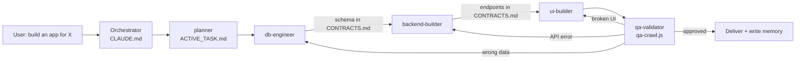

# SSA Framework — Claude Code Edition


A **self-improving coding assistant** framework for [Claude Code](https://docs.anthropic.com/en/docs/claude-code).
Drop it into any project and Claude Code gets persistent memory, a team of specialist subagents that build an app
in phases, an automatic quality hook after every edit, and a browser-based QA validator.

Claude Code starts every session with zero memory and, left alone, writes UI before the API exists. This framework fixes both.

## What it does

- **Persistent memory** — decisions, bugs and lessons survive across sessions (`MEMORY.md` + daily logs).
- **Automatic cascade of subagents** — say "build an app for X" once; the orchestrator runs
  `planner → db-engineer → backend-builder → ui-builder → qa-validator` and routes failures back to the right agent.
- **Contracts between phases** — each agent writes what it delivered to `CONTRACTS.md` (schema, endpoints with
  payload/response) and the next one reads it, so the UI never guesses the API.
- **Quality hook** — `.claude/hooks/verify.sh` runs typecheck/lint after every edit (stack auto-detected).
- **QA like a human** — `tools/qa-crawl.js` opens the app in Chromium, clicks buttons, captures console errors,
  failed requests, broken links and mobile overflow, takes screenshots; Claude reads it all and gives a verdict.
- **Self-improvement** — corrections become lessons; recurring bugs become rules the builders read next time.
- **Task tracking that survives restarts** — the plan and phase checkboxes live in `ACTIVE_TASK.md`.

## How the cascade works



Small requests (one file, one fix) skip the cascade and are solved directly. The manual commands in `commands/`
remain available to trigger any single step by hand.

## Quick start

### 1. Copy into your project root

```bash
git clone https://github.com/Sataker/ssa-framework-claude-code.git /tmp/ssa
cd your-project
cp /tmp/ssa/CLAUDE.md .
cp /tmp/ssa/templates/MEMORY.md /tmp/ssa/templates/ACTIVE_TASK.md /tmp/ssa/templates/CONTRACTS.md .
cp -r /tmp/ssa/commands /tmp/ssa/tools /tmp/ssa/.claude .
mkdir -p memory
rm -rf /tmp/ssa
```

### 2. Fill in the project context

Edit the `## PROJECT CONTEXT` section at the bottom of `CLAUDE.md`:

```markdown
### Tech Stack
Next.js 14, TypeScript, PostgreSQL, Prisma, Tailwind

### Key Directories
src/app/ = pages, src/lib/ = shared utilities, src/components/ = React components

### Testing
Jest for unit tests, Playwright for E2E. Run with `npm test`

### Deployment
main branch auto-deploys to production

### Team Conventions
PR naming: type(scope): description, squash merge only
```

### 3. Update `.gitignore`

Memory files are personal to each developer:

```gitignore
# SSA memory (personal per developer)
memory/*.md
!memory/.gitkeep
MEMORY.md
ACTIVE_TASK.md
CONTRACTS.md
reports/
```

> **Keep `CLAUDE.md`, `.claude/`, `commands/` and `tools/` tracked in git** — they define shared project behaviour.

### 4. Use Claude Code as usual

Claude reads `CLAUDE.md` at session start and follows the protocols. Try: *"Build a small task tracker with login."*

## File structure

```
your-project/
  CLAUDE.md            # Core instructions, orchestration protocol, project rules (committed)
  MEMORY.md            # Long-term curated knowledge (personal, gitignored)
  ACTIVE_TASK.md       # Current plan + phase checkboxes (personal, gitignored)
  CONTRACTS.md         # Schema and endpoint handoff between phases (gitignored)
  memory/
    2026-01-15.md      # Daily log (created during sessions)
  commands/
    review.md          # Code review with severity levels
    debug.md           # Reproduce → locate → hypothesise → verify → fix
    refactor.md        # Test-first refactoring
    test.md            # Tests that follow project patterns
    document.md        # Documentation focused on the non-obvious
    validate.md        # QA validation of a running app
  tools/
    qa-crawl.js        # Playwright crawler: buttons, console, requests, links, screenshots
  .claude/
    settings.json      # PostToolUse hook → verify.sh
    hooks/verify.sh    # typecheck / lint / ruff after each edit
    agents/
      planner.md          # Phased plan, assigns an agent to each phase
      db-engineer.md      # Schema, migrations, queries
      backend-builder.md  # API, business logic, integrations
      ui-builder.md       # Screens, states, responsive, accessible
      qa-validator.md     # Starts the app, runs the crawler, gives a verdict
```

## QA / app validation

```bash
# requirements: Chromium installed + npm install playwright-core
node tools/qa-crawl.js --url https://your-app.com --max 25
# then ask Claude: "validate the app" — it reads the report and screenshots
```

The crawler writes `reports/<host>_<timestamp>/` with `report.md`, `report.json`, `desktop-home.png` and
`mobile-home.png`. It reports console errors, page errors, failed requests (4xx/5xx), broken links, buttons that
can't be clicked or that trigger errors, and horizontal overflow on a 390×844 mobile viewport. Run it before every
deploy to catch regressions in about 30 seconds. The `qa-validator` agent starts your dev server itself, waits for the
port, runs the crawler, analyses the output and stops the server.

## How memory works

**Session start** — Claude reads, in order: `CLAUDE.md` → `MEMORY.md` → today's and yesterday's `memory/` logs →
`ACTIVE_TASK.md` (to resume interrupted work).

**During work** — when something important happens (decision, bug, lesson), Claude writes to `memory/YYYY-MM-DD.md`:

```markdown
# 2026-01-15

## Tasks Completed
- [x] Fixed N+1 query in users endpoint

## Decisions Made
- Decision: Use PostgreSQL instead of MongoDB
- Reason: Need transactions for the payment flow

## Lessons Learned
- **Correction:** Used `any` where the project uses strict typing
- **Root cause:** Didn't check existing patterns before writing new code
- **Fix:** Always read 2–3 existing files for type patterns first
```

**Long-term** — `MEMORY.md` keeps what matters across weeks: architecture decisions, known gotchas, preferences, and
rules written by the QA agent when a bug repeats.

## Custom commands

Add any `.md` file to `commands/`:

```markdown
# Deploy

## Steps
1. Run the full test suite
2. Check for uncommitted changes
3. Verify the branch is up to date with main
4. Build, then deploy using [your method]

## Rules
- Always check staging first
```

Then ask Claude: *"Follow the deploy command."*

## Customisation

- **Coding rules** — edit `## CODING RULES` in `CLAUDE.md`.
- **Make the quality hook blocking** — in `.claude/hooks/verify.sh`, uncomment `exit 2`.
- **Add a specialist** — create `.claude/agents/<name>.md` with a `description` that says when to use it, and
  reference it in the orchestration protocol.

## License

[MIT](./LICENSE) © Enzo Vaccaro
